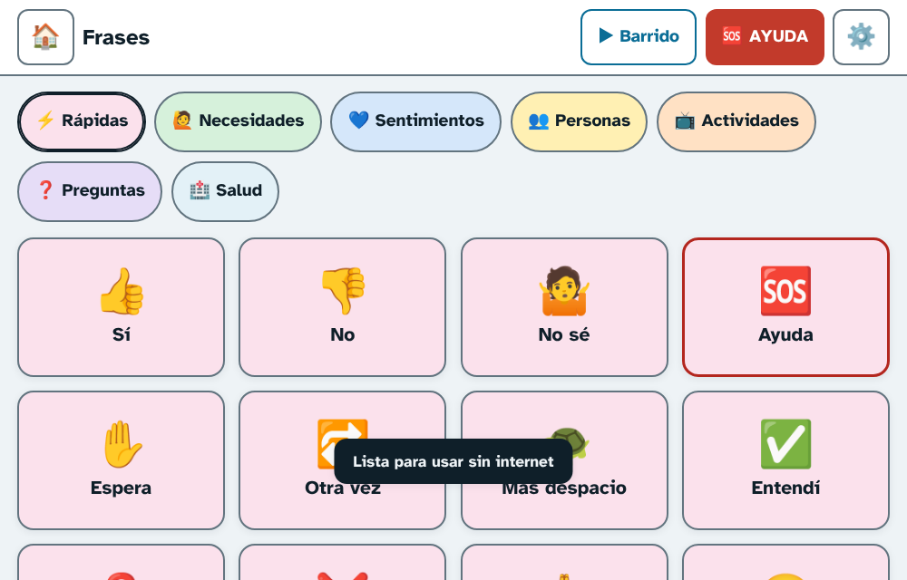

# Talk Again

Tablero de comunicación para una persona que **perdió el habla tras un ACV** (accidente cerebrovascular, también llamado ictus o derrame cerebral) pero entiende lo que se le dice y puede responder con la cabeza, con la mano o con la mirada. Pensado para usarse en la cama del hospital o en casa, en una tablet o un teléfono, por la propia persona o con ayuda de un acompañante.

**Pruébala:** https://jesubarba123.github.io/talk-again/



Es una página web sin servidor: no hay cuentas, no se envía nada a internet y funciona sin conexión una vez instalada. Todo lo que se dice queda guardado en el dispositivo para mostrárselo al personal de salud.

> **Importante: no le den agua, comida ni pastillas por la boca hasta que enfermería o fonoaudiología confirme que puede tragar.** Tras un ACV es muy frecuente la disfagia: el líquido puede irse al pulmón sin que tosa. Si la persona pide agua con la app, avisen a la enfermera.

## Qué hace

| Pantalla | Para qué sirve |
| --- | --- |
| **Sí / No** | Dos botones gigantes (SÍ verde, NO rojo) más «No sé», «Más o menos» y «Repite». El acompañante puede escribir la pregunta para que quede guardada junto con la respuesta. |
| **Frases** | Tablero de pictogramas por categorías: rápidas, necesidades, sentimientos, personas, actividades, preguntas y salud. Al tocar una frase la tablet la dice en voz alta. Incluye frases de reparación («Más despacio», «No entendí», «Eso no», «Escríbanlo») y de seguridad («Me atraganto», «Me voy a caer»). Todo se puede editar. |
| **Armar frase** | Una frase en dos toques: primero cómo empieza («Quiero», «Me duele», «Necesito»…) y luego la continuación. Lo que más se usa va subiendo solo al principio. |
| **Dolor** | Mapa del cuerpo (delante y detrás, con hombros) para señalar dónde duele, escala de 0 a 10 con caras y palabras («7 de 10, fuerte»), y frases sobre el tipo de dolor. |
| **Deletrear** | Teclado grande con predicción de palabras, tilde, y frases guardadas con un toque. Útil si la persona conserva la lectoescritura. |
| **Historial** | Todo lo dicho, con hora, agrupado por día. Se puede copiar para el médico o el cambio de turno. |
| **AYUDA** | Botón siempre visible: se mantiene presionado medio segundo (así un roce no lo dispara), suena una alarma, el borde de la pantalla parpadea y la voz dice «Necesito ayuda». Suena en la tablet: **no sustituye al timbre del hospital**. |
| **Tacto** | Si la mano tiembla o no es precisa: «deslizar y soltar» ilumina y lee la opción bajo el dedo y la elige al soltar; «deslizar y dejar quieto» elige sola tras un instante; «ignorar toques cortos» evita roces accidentales. |
| **Barrido** | Si la persona no puede tocar la pantalla: las opciones se iluminan una a una (por filas y luego dentro de la fila) y se elige tocando cualquier parte de la pantalla, con un pulsador (switch) Bluetooth, con las teclas Espacio/Enter o asintiendo frente a la cámara. |
| **Cámara (experimental)** | Detecta asentir (= Sí) y negar (= No) con la cámara frontal, solo en Sí / No y durante el barrido. Las imágenes se procesan en el dispositivo. |

Ajustes: voz en español y velocidad, tamaño del texto hasta «enorme», tema claro/oscuro, hombre/mujer para las frases, personas importantes (cada nombre crea «Quiero ver a…» y «Llamen a…»), modos de tacto, editor de frases con texto hablado y orden, y copia de seguridad en texto que se puede compartir por WhatsApp. Lo avanzado (barrido, cámara, teclado) está plegado para no abrumar.

## Probar ahora

1. **Sin instalar nada:** abran https://jesubarba123.github.io/talk-again/ en el navegador de la tablet o el teléfono.
2. **En local:** descarguen el repositorio y abran `index.html` en Chrome, Edge o Safari. O ejecuten `npm start` y entren en `http://localhost:8080`.
3. **Instalar en la tablet o el teléfono** (ocupa toda la pantalla y funciona sin internet):
   - Android / Chrome: menú ⋮ → **Agregar a pantalla de inicio** (o «Instalar aplicación»).
   - iPhone / iPad / Safari: botón Compartir → **Agregar a pantalla de inicio**. En iPad la app instalada tiene su propio almacén: instálenla primero, ábranla una vez con internet y configuren todo **dentro de la app instalada** (lo que se configure en Safari no pasa a la app). Si la usan en una pestaña de Safari, no la dejen más de 7 días sin abrir: iOS borra sus datos.

Para que se oiga la voz, suban el volumen y toquen cualquier botón una primera vez (los navegadores exigen un toque antes de reproducir sonido). En Android conviene tener la app de voz de Google («Speech Recognition & Synthesis», antes «Síntesis de voz de Google») con español; en iPhone/iPad, Configuración → Accesibilidad → Contenido hablado → Voces → Español. Las voces que «necesitan internet» se quedan mudas en el hospital: la app prefiere las que no.

## Cómo usarlo con la persona

Lean la [guía para la familia](docs/GUIA-FAMILIA.md). Resumen:

- Primero acuerden un **sí y un no claros** (asentir y negar, levantar la mano, mirar a la derecha…) y compruébenlos cada día con preguntas obvias. Pidan a la fonoaudióloga que lo evalúe formalmente antes de usarlo para decisiones médicas.
- Hagan **una pregunta cerrada a la vez**, de lo general a lo concreto: «¿Necesitas algo?» → «¿Es dolor?» → «¿En la cabeza?». Las pantallas **Dolor** y **Armar frase** acortan ese camino.
- Repitan en voz alta lo que entendieron antes de actuar.
- La persona se cansa rápido. Sesiones cortas, y el **Historial** evita volver a preguntar lo mismo en cada turno.

## Barrido y pulsadores

Toquen **▶ Barrido** en la barra superior. Las filas se iluminan una a una; al elegir una fila, se iluminan sus opciones. Para elegir:

- tocar en cualquier parte de la pantalla (configurable), o el botón **SELECCIONAR**;
- un pulsador (switch) de accesibilidad Bluetooth (la mayoría envía la tecla Espacio o Enter);
- teclado: Espacio/Enter elige, flechas avanzan o retroceden, Escape vuelve atrás;
- cámara: asentir elige, negar vuelve atrás.

Tras unas vueltas sin elegir (configurable) el barrido se detiene en espera para no cansar; cualquier toque, pulsación o gesto lo reanuda. El botón **Pausa** deja la pantalla en modo normal para que el acompañante toque directamente (y se mantiene al cambiar de pantalla). Mientras el barrido está activo y se elige tocando, la pantalla se mantiene encendida.

Las tablets también tienen barrido integrado con pulsadores: **Control por botón** en iPad/iPhone (Configuración → Accesibilidad) y **Acceso con interruptores** en Android. Si usan uno de esos, dejen apagado el barrido de la app: ya lo hace el sistema.

## Cámara: asentir y negar

En Ajustes → Ajustes avanzados → Cámara, activen «Detectar gestos de cabeza» y toquen «Probar ahora». La primera vez el navegador pide permiso de cámara y descarga el detector (unos 14 MB, hace falta internet solo esa vez; después queda guardado). Un recuadro pequeño muestra la cámara y el estado: «Buscando la cara…», «Cara detectada», «Asentir: SÍ».

- En **Sí / No**, asentir responde SÍ y negar responde NO.
- Con el **barrido** activo, asentir elige la opción iluminada y negar vuelve a la lista de filas.
- En las demás pantallas los gestos no hacen nada, para evitar respuestas falsas al mirar alrededor.
- Ajusten la **sensibilidad** si no detecta gestos pequeños (suban) o detecta movimientos involuntarios (bajen).

Es experimental: necesita buena luz, la cara de frente y la tablet estable (un soporte ayuda). Movimientos involuntarios pueden dar respuestas falsas: úsenla para practicar, no para decisiones importantes. La detección usa [MediaPipe Face Landmarker](https://ai.google.dev/edge/mediapipe/solutions/vision/face_landmarker) dentro del navegador; ninguna imagen sale del dispositivo.

## Publicar en GitHub Pages

El repositorio incluye el workflow `.github/workflows/pages.yml`, que intenta activar Pages por sí mismo. Requisitos: el repositorio debe ser **público** (en cuentas gratuitas de GitHub, Pages no funciona en repositorios privados) y, si el workflow no consigue activarlo, una sola vez: **Settings → Pages → Build and deployment → Source: GitHub Actions**. Cada cambio en `main` se publica en `https://jesubarba123.github.io/talk-again/`. El workflow versiona la caché del service worker con cada despliegue, así las tablets instaladas reciben la versión nueva al reabrir la app.

## Desarrollo

Sin frameworks ni compilación. Archivos:

- `index.html`, `styles.css`: estructura y estilos (tokens de color con contrastes revisados para baja visión, tema claro/oscuro, tamaños grandes para temblor).
- `data.js`: vocabulario por defecto en español neutro, mapa del cuerpo, orden de letras y palabras para la predicción. `{o}` en una frase se convierte en «o» o «a» según el ajuste hombre/mujer.
- `app.js`: voz, barrido, tacto, pantallas, historial, ajustes y copia de seguridad.
- `nod-detector.js`: detección de asentir/negar con la cámara.
- `sw.js`, `manifest.webmanifest`, `icons/`, `fonts/`: instalación, uso sin conexión y tipografía Atkinson Hyperlegible (diseñada para baja visión, licencia OFL).
- `tests/smoke.mjs`: prueba de humo con Playwright (recorre todas las pantallas, comprueba barrido, tacto, historial, ajustes y que no hay desbordamiento en móvil, también con texto enorme).

```bash
npm install          # solo para las pruebas (Playwright)
npm test             # ejecuta tests/smoke.mjs
npm start            # servidor local en http://localhost:8080
```

Los pictogramas son emojis del propio dispositivo, así no hay que descargar imágenes. Si quieren pictogramas más claros, una mejora natural es usar los de [ARASAAC](https://arasaac.org/) (gratuitos para uso no comercial).

## Apps ya existentes que vale la pena probar

Antes o además de esta app, conviene probar lo que ya existe; un fonoaudiólogo (logopeda) puede ayudar a elegir según cómo estén la comprensión, la lectura y la movilidad de la persona.

- [**Cboard**](https://www.cboard.io/) — gratuita y de código abierto, en español, con pictogramas, para web, Android, iOS y Windows. Muy parecida en espíritu a Talk Again, con muchos más símbolos.
- [**Háblalo**](https://hablalo.app/) — app argentina gratuita (Android/iOS) que convierte texto en voz y voz en texto, funciona sin internet.
- [**Look to Speak**](https://play.google.com/store/apps/details?id=com.androidexperiments.looktospeak) (Google, Android, gratuita) — se eligen frases moviendo los ojos a izquierda o derecha; disponible en español.
- **Habla en vivo (Live Speech)** en iPhone/iPad, incluido en iOS: se escribe y el dispositivo lo dice en voz alta, también en llamadas. Configuración → Accesibilidad → Habla en vivo.
- **Proloquo2Go**, **TD Snap**, **Grid** — apps profesionales de pago con español, mucho vocabulario y soporte de pulsadores y mirada; suelen recomendarlas los fonoaudiólogos cuando la comunicación aumentativa va a ser de largo plazo.
- [**VerbalizAPP**](https://www.idipaz.es/ficheros/files/35_a%20VerbalizApp.pdf) — app de rehabilitación de la afasia desarrollada con el Hospital La Paz (Madrid), orientada a terapia más que a comunicación diaria.
- [**Yes or No**](https://github.com/akramhussein/yes-or-no) — proyecto abierto para iPad creado para una persona tras un ACV: solo Sí/No, pensado para usar con el Control por botón.

## Importante

Esta herramienta **no sustituye** la valoración de un **fonoaudiólogo o logopeda** ni del equipo de rehabilitación. Tras un ACV, el habla puede mejorar durante meses con terapia; la comunicación aumentativa sirve para comunicarse mientras tanto y reduce la frustración, no frena la recuperación. Pidan al hospital una valoración de comunicación aumentativa y de deglución lo antes posible. El historial contiene información de salud: compártanlo solo con el equipo que atiende a la persona.
